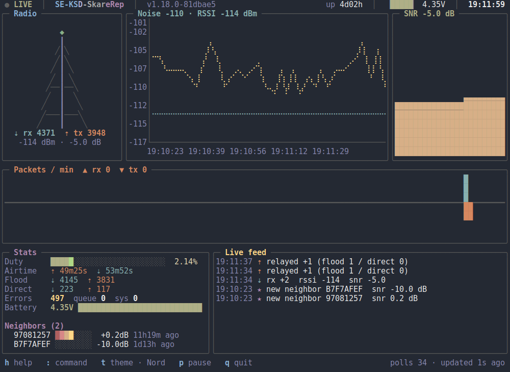
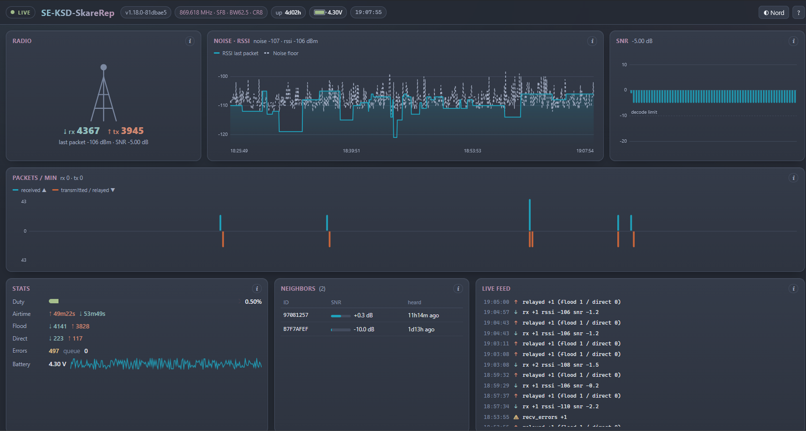

# meshtui

Live dashboard for a MeshCore repeater over its serial console. Runs as a terminal UI, a web
dashboard, or a Prometheus exporter. Polling only uses read-only CLI commands.



## Quick start

    ./meshtui -demo                   # simulated data, no radio needed
    make deploy                       # build static binary, copy to neipa.wg
    ssh -t neipa.wg ./meshtui         # run against /dev/ttyUSB-heltecv3

- Keys: `h` help · `:` command · `t` theme · `p` pause · `q` quit
- Flags: `-dev` `-baud` `-interval` `-demo`

The `:` prompt sends any CLI command. Read-only commands (`get …`, `ver`, `clock`, `neighbors`,
`log`, `stats-*`) run at once. Anything else asks y/n first.

## Web dashboard



    ./meshtui -web :8080 -web-user admin -web-pass 'secret'               # dashboard
    ./meshtui -web :8080 -web-user admin -web-pass 'secret' -web-console  # + command console
    ./meshtui -web :8080 -listen :9110 >access.log 2>error.log           # + /metrics, log to files

- `-web` replaces the TUI. The terminal shows logs:
  - stdout: access log (Combined Log Format + duration).
  - stderr: startup, signal lost/restored, reboots, errors, and an audit line per console command
    (secrets redacted).
- Single binary, no CDN, no build step. Updates stream over Server-Sent Events.
- `-web-console` requires basic auth. Non-read-only commands ask for confirmation.
- Password: `-web-pass` (visible in `ps`), `-web-pass-file FILE`, or `MESHTUI_WEB_PASS=…`.
- HTTPS: `-web-tls-cert cert.pem -web-tls-key key.pem`, or use a reverse proxy.
- Limits: 32 browser connections; stalled clients dropped after 10 s.

## Prometheus

    ./meshtui -listen :9110           # TUI + /metrics
    ./meshtui -headless               # /metrics only on :9110 (systemd: deploy/meshtui.service)

Scrape config:

```yaml
- job_name: meshcore
  static_configs: [{targets: ['neipa.wg:9110']}]
```

Exports up/info, battery, uptime, queue, noise floor, RSSI/SNR, airtime, packet counters
(rx/tx, flood/direct), receive errors and per-neighbor SNR. Device metrics are hidden after 3
failed polls, so alert on `meshcore_up == 0`.

## Docker

    docker build -t meshtui:local .
    docker run --rm -it meshtui:local -demo                    # TUI on demo data
    docker compose up -d                                       # web :8080 + /metrics :9110
    docker compose stop web && docker compose run --rm tui     # TUI on the real radio

- Distroless, UID 65532, read-only root filesystem.
- Default command runs the web dashboard. Your own args replace it; without `-web` or `-headless`
  you get the TUI.
- Serial access needs `--device` and `--group-add <dialout GID>`.
- See the `docker-compose.yaml` header for setup.

## Release

Push a `v*` tag on a `main` commit. `.github/workflows/release-image.yaml` tests, builds
linux/amd64 + linux/arm64, and pushes to `ghcr.io/<owner>/<repo>`. To use another registry, set
the `REGISTRY`, `IMAGE_NAME`, `REGISTRY_USERNAME` variables and the `REGISTRY_PASSWORD` secret.
